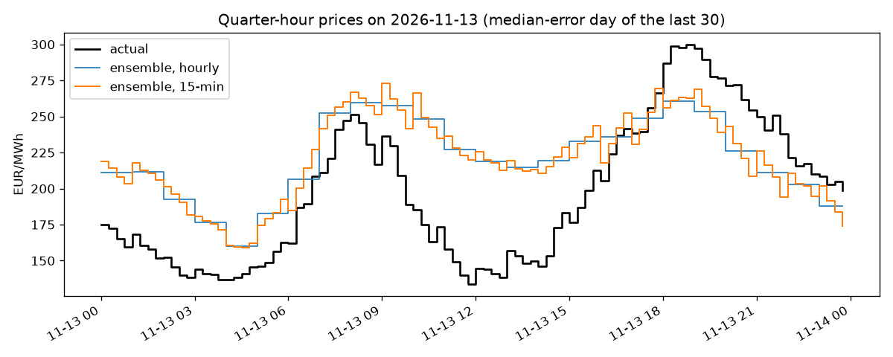

# French Day-Ahead Electricity Price Forecasting


Quarter-hour by quarter-hour forecasts of the French day-ahead electricity price (SDAC
auction), built from free public data (ENTSO-E Transparency Platform, Open-Meteo, Yahoo
Finance) and evaluated with a strict **walk-forward** protocol over 2021–2026. This period
covers the 2022 energy crisis, the surge in negative prices and the auction's switch from
hourly to 15-minute products on 1 October 2025.

The project focuses on doing the basics rigorously:

- **Gate-aligned information set.** Every input must be public before the 12:00 auction
  gate on D-1. Tests check this by perturbing future data.
- **The market's own resolution.** The forecast covers the 96 quarter-hours of each day: an
  hourly level learned on the full history, plus an intra-hour shape learned on the
  15-minute prices.
- **Strong benchmarks.** Models are compared with Diebold–Mariano tests.
- **Calibrated prediction intervals.** Their real coverage is reported, not only the
  nominal one.
- **Forecasts turned into orders.** A battery bids on the auction from the forecasts, and
  the strategies are scored in euros, not only in MAE.

**Key results** (202,312 out-of-sample quarter-hours, January 2021 to November 2026):

| Model | MAE (€/MWh) | RMSE (€/MWh) | rMAE vs naive | 90% interval coverage |
|---|---:|---:|---:|---:|
| naive | 29.40 | 53.34 | 1.00 | 87.2% |
| **lasso** | **24.55** | **41.10** | **0.84** | 87.4% |
| lightgbm | 35.68 | 61.23 | 1.21 | 85.1% |
| extra_trees | 26.35 | 43.20 | 0.90 | 86.6% |
| ensemble (median) | 25.60 | 42.68 | 0.87 | 86.6% |

Since the switch to 15-minute products (36,644 quarter-hours, October 2025 to November 2026):

| Forecast | MAE (€/MWh) | rMAE vs naive |
|---|---:|---:|
| naive (same quarter, previous day or week) | 32.47 | 1.00 |
| ensemble, hourly forecast repeated on its four quarters | 27.00 | 0.83 |
| **ensemble + intra-hour shape** | **26.17** | **0.81** |

- **The Lasso is the best model over the full period.** It is 16% more accurate than the
  naive benchmark, and better than every other model (Diebold–Mariano p < 0.001).
- **Since 2023, the median ensemble is the most accurate model in every year.** In
  2021–2022, tree models broke down because prices rose far above anything in their
  training data.
- **The 15-minute shape is predictable.** Quarters deviate from their hourly mean by
  7.6 €/MWh on average. The shape model cuts that error by 27%, to 5.5 €/MWh.
- **In euros, better forecasts are worth less than MAE suggests.** A 1 MW / 2 MWh battery
  bidding from the forecasts captures 86% of its perfect-foresight profit with price-quantity
  bid curves, against 80% when it simply trusts the naive forecast.


---

## Contents

- [The forecasting problem](#the-forecasting-problem)
- [Method](#method)
- [Results](#results)
- [From forecasts to bids: a battery on the auction](#from-forecasts-to-bids-a-battery-on-the-auction)
- [Quickstart](#quickstart)
- [Project structure](#project-structure)
- [Limitations and next steps](#limitations-and-next-steps)

## The forecasting problem

Every day before 12:00 CET, buyers and sellers submit bids for the next day to the
European day-ahead auction. Until 30 September 2025 the auction cleared 24 hourly prices;
since 1 October 2025 it clears 96 quarter-hour prices. Forecasting those prices on the
morning of D-1 is the canonical electricity price forecasting (EPF) task.

France is an interesting case:

- roughly two-thirds of its electricity is nuclear;
- demand is very temperature-sensitive because of electric heating;
- the market went through extreme regimes: the 2021–2022 crisis (gas shock combined with
  record-low nuclear availability), then a return to lower prices with frequent negative
  prices driven by solar.

## Method

### Information set: what is known on D-1 before the 12:00 gate

The usual way a price model "cheats" is by using data that is not yet available when the
forecast is made. A common example in the literature is the TSO's day-ahead wind and solar
forecasts. ENTSO-E publishes them for day D only *after* the auction (RTE at about 16:15,
legal deadline 18:00), so they cannot be used as inputs for day D.

| Feature group | Source | Timing used |
|---|---|---|
| Past prices: lags 24h / 48h / 168h, 24h and 168h rolling mean and std | ENTSO-E | Day D-1 and earlier (lag ≥ 24h) |
| Load forecast for day D | ENTSO-E (TSO, published ≥ 2h before the gate) | As published for day D |
| Wind and solar forecasts, residual load proxy (load minus wind minus solar) | ENTSO-E (TSO) | Forecasts **for day D-1** (published on D-2) |
| Gas cost of power: TTF front-month close / 0.52 efficiency | Yahoo Finance | Last close dated D-2 or earlier |
| Realized generation by type (nuclear, hydro, gas, …) | ENTSO-E | Lagged 48h (day D-2) |
| Population-weighted temperature, heating and cooling degree days | Open-Meteo archive | Lagged 48h (day D-2) |
| Hour, weekday, month, weekend, French public holidays | Calendar | Known in advance |

`tests/test_features.py` perturbs, in turn, the prices of day D, the wind/solar forecasts
for day D, the gas closes of D-1, and the realized data of D-1. Each time, it asserts that
none of day D's features change. `tests/test_quarter_hour.py` does the same for the
15-minute features below.

### From hourly to 15-minute forecasts

Fifteen-minute prices exist only since October 2025, about a year of data: too little to
train the full models on. The forecast is therefore built in two stages
(`src/fr_power/quarter_hour.py`):

1. **Hourly level.** The models below forecast the hourly average price, trained on the
   whole history since 2019.
2. **Intra-hour shape.** A Lasso forecasts each quarter's deviation from its hourly mean.
   It is trained on 15-minute prices only, refitted every week. Its features are all known
   before the gate:
   - the quarter's position in the hour;
   - the same quarter's deviation on D-1, and its average over the last 7 and 28 days;
   - the ramp of the hourly price forecast around that hour, times the quarter position;
   - the within-hour variation of the load forecast for D and of the wind and solar
     forecasts for D-1.

   Before the switch the shape is zero: the four quarters of an hour shared one price.

The ramp is computed from forecasts for day D only. At 23:00, a centred slope would use the
forecast for 00:00 on D+1, which is built from day D's prices.

Fetching the prices also needed care. After the switch, the ENTSO-E client's default hourly
query returns the price of each hour's **first quarter**, not the hourly average (10.7 €/MWh
apart on average). The prices are now downloaded at the resolution of the traded products.

### Models

| Model | Description |
|---|---|
| `naive` | Standard EPF benchmark: same hour one week earlier on Mondays and weekends, one day earlier otherwise |
| `lasso` | Standardized linear regression with an L1 penalty, alpha chosen by time-series CV. A LEAR-style model, using one regression across hours rather than 24 hourly models |
| `lightgbm` | Gradient-boosted trees, early-stopped on the most recent 10% of each training window |
| `extra_trees` | Extremely randomized trees, a robust tree benchmark |
| `ensemble` | Hour-by-hour median of `lasso`, `lightgbm` and `extra_trees` |

Each model's 15-minute forecast is its hourly forecast plus the shared intra-hour shape. The
15-minute `naive` repeats each quarter's price from the previous day, or from the previous
week on Mondays and weekends.

### Evaluation protocol

- **Expanding-window walk-forward.** Each model is trained on two years of history,
  predicts the next 30 days, then the window expands and every model is refitted from
  scratch. Folds start at local midnight, so no model ever sees a price from the auction
  it forecasts.
- **Scored per quarter-hour.** Before October 2025 a quarter's price is its hour's price,
  so the yearly results up to 2024 are identical to an hourly evaluation.
- **Same quarter-hours for every model.** Metrics are computed only where all models have
  a forecast.
- **Metrics.** MAE, RMSE, median absolute error, and rMAE (MAE relative to the naive model;
  below 1 beats naive).
- **Diebold–Mariano tests.** The forecasts of a day are issued together, so their errors
  are correlated. The absolute-loss differential is averaged per day before testing.
- **90% prediction intervals: rolling split-conformal.** For each quarter-hour of the day,
  the half-width is the 90% quantile of that quarter's absolute errors over the previous 60
  days.
  It uses only errors known at decision time. Intervals are scored on coverage, width, and
  interval (Winkler) score (`reports/intervals.csv`).

## Results

Out-of-sample MAE by year (€/MWh):

| Year | naive | lasso | lightgbm | extra_trees | ensemble | Market context |
|---|---:|---:|---:|---:|---:|---|
| 2021 | 20.19 | **17.86** | 49.10 | 22.23 | 21.99 | Gas prices take off in H2 |
| 2022 | 53.00 | **45.41** | 77.77 | 50.29 | 49.27 | Energy crisis, mean price €276/MWh |
| 2023 | 23.45 | 19.43 | 18.93 | 19.33 | **18.46** | Nuclear fleet recovers |
| 2024 | 21.74 | 18.08 | 18.77 | 18.05 | **17.54** | 352 negative-price hours |
| 2025 | 24.01 | 18.81 | 19.14 | 18.83 | **18.33** | 509 negative-price hours; 15-minute products from October |
| 2026 | 34.29 | **27.78** | 28.68 | 29.30 | 27.87 | Higher, more volatile prices (to mid-November) |

**What this shows**

1. **Fundamentals plus recent prices beat persistence.** The Lasso cuts the naive error by
   12–22% every year. All pairwise Diebold–Mariano tests reject equal accuracy
   (`reports/dm_tests.csv`).
2. **Regime shifts hurt tree models.** When 2021–2022 prices rose far above anything in the
   training window, LightGBM, which can only predict values within the range of its
   training targets, was much worse than the naive forecast. Once the crisis is part of
   the training history, trees catch up, and the median ensemble becomes the best model
   in 2023–2025 (in 2026 so far, the Lasso is marginally better).
3. **What drives the forecast.** The previous day's price dominates, followed by the
   two-day lag, the residual load proxy, the weekly lag and the gas cost (LightGBM split
   gain, notebook 02).
4. **Intervals are slightly too narrow.** The 90% conformal intervals cover 85–87% of
   hours overall. Coverage is close to target in calm years (88–90% in 2023–2025) and
   drops when the regime shifts (81% in 2021), because a 60-day window adapts with a lag.


### What changed the numbers

| Step | Lasso MAE | Comment |
|---|---:|---|
| TSO wind/solar forecasts for day D used as inputs | 22.90 | Not a valid result: those forecasts are published after the gate |
| Same forecasts shifted to day D-1 (published on D-2) | 24.83 | The honest baseline, 8% worse |
| + gas cost (TTF close of D-2) | **24.58** | Final feature set |
| + Extra Trees and median ensemble | 25.59 (ensemble) | Best model in 2023–2025 |
| Scored per quarter-hour, prices fetched at product resolution, + intra-hour shape | 24.55 | Since the switch, the shape cuts the ensemble's quarter-hour MAE from 27.00 to 26.17 |

Also tested and **not kept**, because they did not improve overall accuracy:

- trees learning a scale-free target (price minus last week's mean, or price divided by
  gas cost). These helped in 2021–2022 but hurt afterwards;
- exponential recency weighting of training samples (one-year half-life). No measurable
  effect.

The two notebooks go further:

- [`01_data_exploration.ipynb`](notebooks/01_data_exploration.ipynb): price regimes,
  negative prices, the solar dip, generation mix, temperature sensitivity, and the
  intra-hour shape of 15-minute prices.
- [`02_forecast_evaluation.ipynb`](notebooks/02_forecast_evaluation.ipynb): accuracy by year
  and hour, Diebold–Mariano tests, interval coverage by year, the 15-minute shape's
  contribution, sample weeks, LightGBM feature importance.



## From forecasts to bids: a battery on the auction

A desk does not trade a forecast, it submits orders. `fr-power bid` replays the out-of-sample
period as a small battery operator (1 MW / 2 MWh, 88% round-trip efficiency, empty at the
start of each day) bidding on the day-ahead auction every day. The backtest still uses
hourly orders and the hourly forecasts; moving it to 15-minute orders is the next step.

**Why a forecast matters for bidding.** A small, flexible generator should simply offer at
its marginal cost, whatever the forecast. A battery is different: the value of charging at
13:00 depends on the price it will sell at in the evening, so its bids depend on the whole
day's price shape.

**Strategies** (`src/fr_power/bidding.py`):

| Strategy | Orders submitted |
|---|---|
| `perfect_foresight` | Optimal schedule computed on the realized prices: the upper bound |
| `schedule_<model>` | Optimal schedule on the model's point forecast, submitted as fixed quantities whatever the price |
| `curves_ensemble` | One price-quantity curve per hour, optimized over 60 price scenarios: the ensemble forecast plus each of the previous 60 days' error vectors. A linear program maximizes the expected profit, with curves that are monotone in price (as SDAC orders must be) and a dispatch that is feasible in every scenario (Fleten & Pettersen, 2005) |

**Settlement.** Each hour's executed volume is read on its curve at the cleared price. If
the cleared prices fall outside the scenarios, the curves can commit the battery to sell
energy it does not hold. It then delivers the closest feasible dispatch, and the gap is
traded back at the day-ahead price plus a 50 €/MWh penalty (a proxy for the imbalance
price). That dispatch only minimizes the gap, so the penalty can never be used to re-trade
with hindsight.

| Strategy | Profit (€/MW/year) | Share of perfect foresight | Cycles/day |
|---|---:|---:|---:|
| perfect_foresight | 76,300 | 100% | 1.81 |
| schedule_naive | 61,400 | 80.4% | 1.81 |
| schedule_lasso | 64,400 | 84.4% | 1.76 |
| schedule_ensemble | 63,700 | 83.5% | 1.69 |
| **curves_ensemble** | **65,300** | **85.6%** | 1.76 |

2,085 delivery days (2021 to November 2026); per-year results are in
`reports/bidding_by_year.csv`.

**What this shows**

1. **Forecast accuracy is worth less than its MAE gain.** The Lasso cuts the naive error by
   16%, but adds only 4 points of captured profit. A battery needs the *ranking* of the
   hours (cheap midday, expensive evening), and the naive forecast already gets that ranking
   mostly right.
2. **Bidding curves beat fixed quantities in every year.** Against the schedule built on the
   same forecast, they earn 900 to 2,800 €/MW more per full year (700 in the partial year
   2026). The gain comes from hours where the decision depends on the price: buy at night
   only if the price is negative, or sell less in the morning if the price turns out low
   (right panel below). On most hours the optimal curve is flat, and the battery trades the
   same volume whatever the price.
3. **The imbalance risk of curves is tiny.** Committed volumes the battery could not deliver
   average 0.002 MWh/day.


## Quickstart

Requirements: Python 3.11+ and [uv](https://docs.astral.sh/uv/).

```bash
git clone https://github.com/Baptiste251001/fr-day-ahead-price-forecasting.git
cd fr-day-ahead-price-forecasting
uv sync --extra dev               # add --extra notebooks for Jupyter
cp .env.example .env              # then paste your ENTSO-E API token
```

**ENTSO-E token.** Create a free account on the
[Transparency Platform](https://transparency.entsoe.eu/), then email
`transparency@entsoe.eu` with the subject "Restful API access" from the account's email
address. Once access is granted (usually within a few days), generate the token under
*My Account Settings*.

```bash
uv run fr-power fetch      # download 2019 -> today to data/raw/ (~15 min, cached)
uv run fr-power features   # build data/processed/feature_matrix.parquet
uv run fr-power train      # walk-forward, hourly level + 15-min shape (~15 min) -> reports/
uv run fr-power bid        # battery bidding backtest on the forecasts (~20 min)
```

All settings (dates, lags, walk-forward schedule, hyperparameters, ensemble members) live in
[`configs/default.yaml`](configs/default.yaml). To run a variant, copy the file and pass it
with `--config`.

## Project structure

```
configs/default.yaml        all run settings
src/fr_power/
├── data.py                 ENTSO-E, Open-Meteo and gas-price download, parquet cache
├── features.py             point-in-time feature matrix
├── models.py               naive / lasso / LightGBM / Extra Trees, ensemble, walk-forward
├── quarter_hour.py         15-minute stage: intra-hour shape on top of the hourly level
├── evaluation.py           metrics, Diebold-Mariano tests, conformal intervals
├── bidding.py              battery bid curves (scenario LP), settlement, profit backtest
└── cli.py                  `fr-power fetch | features | train | bid`
tests/                      offline tests (all network calls mocked)
notebooks/                  data exploration and forecast evaluation
reports/                    metric tables and figures produced by `train`
```

Development checks (ruff and mypy also run as pre-commit hooks):

```bash
uv run pytest
uv run ruff check . && uv run ruff format --check .
uv run mypy src
```

## Limitations and next steps

- **No weather forecasts for day D.** The model sees observed temperature from D-2 and the
  TSO's wind and solar forecasts for D-1. Open-Meteo's archive of forecasts issued before
  the gate starts only in early 2024 for wind and solar, too short to train on yet. As
  that archive grows, adding them is the most promising extension. In the live
  EnergyBench benchmark (Genov et al., 2026), giving models weather forecasts and other
  covariates cut price errors by 15–34%.
- **No carbon price.** A free daily EU carbon (EUA) series exists only from late 2021, so
  the fuel-cost feature uses gas alone.
- **A short 15-minute history.** The intra-hour shape is learned on about a year of
  15-minute prices, and the hourly level carries most of the error. The bidding backtest
  still trades hourly products.
- **Simplified LEAR.** A full LEAR uses 24 hourly models and a variance-stabilizing
  transform (e.g. asinh) of prices.
- **Untuned hyperparameters.** No search was run inside the walk-forward loop.
- **A stylized battery.** It is a price-taker that only trades the day-ahead auction, with no
  intraday re-optimization, ancillary services, degradation cost, cycle limit or exchange
  fees, and it is empty at the start of every day. Real French batteries earn much of their
  revenue from frequency reserves and run fewer cycles than 1.8 per day.

## License

[MIT](LICENSE)
