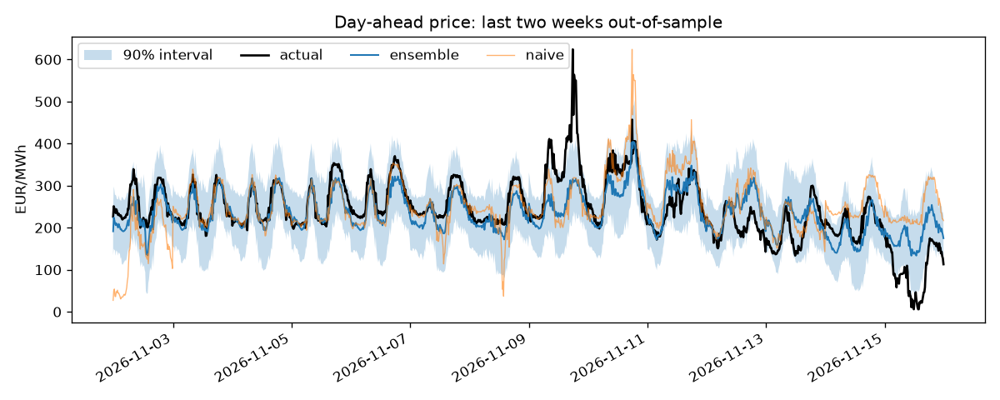

# French Day-Ahead Electricity Price Forecasting


Hour-by-hour forecasts of the French day-ahead electricity price (EPEX SPOT / SDAC auction),
built from free public data (ENTSO-E Transparency Platform, Open-Meteo) and evaluated with a
strict **walk-forward** protocol over 2021–2026, a period that includes the 2022 energy crisis
and the rise of negative prices.

The project focuses on doing the basics rigorously: a leakage-free information set, strong
benchmarks, and statistical tests of forecast accuracy.

**Key results** (51,224 out-of-sample hours, January 2021 to November 2026):

| Model | MAE (€/MWh) | RMSE (€/MWh) | rMAE vs naive |
|---|---:|---:|---:|
| naive | 29.41 | 53.23 | 1.00 |
| **lasso** | **22.90** | **40.09** | **0.78** |
| lightgbm | 32.46 | 58.68 | 1.10 |

- The regularized linear model beats the naive benchmark by 22% in MAE over the whole
  period (Diebold–Mariano p < 0.001), and it does so in every single year.
- LightGBM matches or beats the Lasso from 2023 onwards, but it fails during the
  2021–2022 crisis because trees cannot extrapolate to price levels absent from their
  training data.


---

## Contents

- [The forecasting problem](#the-forecasting-problem)
- [Method](#method)
- [Results](#results)
- [Quickstart](#quickstart)
- [Project structure](#project-structure)
- [Limitations and next steps](#limitations-and-next-steps)

## The forecasting problem

Every day before 12:00 CET, buyers and sellers submit bids for each hour of the next day to
the European day-ahead auction. Forecasting those 24 prices on the morning of D-1 is the
canonical electricity price forecasting (EPF) task.

France is an interesting case: roughly two-thirds of its electricity is nuclear, demand is very
temperature-sensitive because of electric heating, and the market went through extreme
regimes: the 2021–2022 crisis (gas shock combined with record-low nuclear availability),
followed by a rapid return to low prices and frequent negative prices driven by solar.

## Method

### Information set: what is known on D-1 before 12:00

The usual way a price model "cheats" is by using data that is not yet available when the
forecast is made. Every feature here is built so that it is known at decision time, and
`tests/test_features.py` checks this by perturbing future data and asserting that the
features do not change.

| Feature group | Source | Timing used |
|---|---|---|
| Past day-ahead prices: lags 24h / 48h / 168h, 24h and 168h rolling mean and std | ENTSO-E | Prices of day D-1 and earlier only (lag ≥ 24h) |
| Load forecast, wind and solar forecasts for day D, residual load | ENTSO-E (TSO day-ahead forecasts) | As published for day D |
| Realized generation by type (nuclear, hydro, gas, …) | ENTSO-E | Lagged 48h (same hour, day D-2) |
| Population-weighted temperature, heating and cooling degree days | Open-Meteo archive | Lagged 48h (day D-2) |
| Hour, weekday, month, weekend, French public holidays | Calendar | Known in advance |

All inputs are averaged onto an hourly grid. ENTSO-E switched several French series to
15-minute resolution with the EU 15-minute market time unit.

### Models

| Model | Description |
|---|---|
| `naive` | Standard EPF benchmark: same hour one week earlier on Mondays and weekends, one day earlier otherwise |
| `lasso` | Standardized linear regression with an L1 penalty, alpha chosen by time-series CV. A LEAR-style model, using one regression across hours rather than 24 hourly models |
| `lightgbm` | Gradient-boosted trees, early-stopped on the most recent 10% of each training window |

### Evaluation protocol

- **Expanding-window walk-forward.** Each model is trained on two years of history,
  predicts the next 30 days, then the window expands and every model is refitted from
  scratch. Every reported number is out-of-sample.
- **Same hours for every model.** Metrics are computed only on the hours where all models
  have a forecast.
- **Metrics.** MAE, RMSE, median absolute error, and rMAE (MAE relative to the naive model;
  below 1 beats naive).
- **Diebold–Mariano tests.** The 24 forecasts of a day are issued together, so their errors
  are correlated. The absolute-loss differential is averaged per day before testing.

## Results

Out-of-sample MAE by year (€/MWh). Each year is scored on hours predicted by models
trained only on earlier data:

| Year | naive | lasso | lightgbm | Market context |
|---|---:|---:|---:|---|
| 2021 | 20.25 | **18.05** | 47.63 | Gas prices take off in H2 |
| 2022 | 53.00 | **43.46** | 71.99 | Energy crisis, record-low nuclear output, mean price €276/MWh |
| 2023 | 23.42 | **17.80** | 18.29 | Nuclear fleet recovers, prices normalise |
| 2024 | 21.73 | 16.66 | **15.45** | 352 negative-price hours |
| 2025 | 24.40 | 16.51 | **16.21** | 509 negative-price hours |
| 2026 | 34.38 | 25.36 | **24.63** | Higher, more volatile prices (to mid-November) |

**What this shows**

1. **Fundamentals plus recent prices beat persistence.** The Lasso cuts the naive error by
   11–32% depending on the year. The Diebold–Mariano tests on daily-averaged losses
   (`reports/dm_tests.csv`) reject equal accuracy for every pair of models at p < 0.001.
2. **Regime shifts hurt tree models.** When 2021–2022 prices rose far above anything in
   the training window, LightGBM, which can only predict values within the range of its
   training targets, was worse than the naive forecast. A linear model extrapolates
   naturally. Once the crisis is part of the training history (2023+), LightGBM catches up
   and is slightly ahead from 2024, as it captures non-linear effects such as
   solar-driven negative prices.
3. **What drives the forecast.** The previous day's price and the residual load forecast
   (load minus wind and solar) carry most of the predictive power, followed by the wind
   forecast and weekly lags (LightGBM split gain, notebook 02). Errors peak at the
   morning and evening ramps (08:00 and 19:00).



The two notebooks go further:

- [`01_data_exploration.ipynb`](notebooks/01_data_exploration.ipynb): price regimes,
  negative prices, the solar dip, generation mix, temperature sensitivity.
- [`02_forecast_evaluation.ipynb`](notebooks/02_forecast_evaluation.ipynb): accuracy by
  year and by hour, Diebold–Mariano tests, sample weeks, LightGBM feature importance.

## Quickstart

Requirements: Python 3.11+ and [uv](https://docs.astral.sh/uv/).

```bash
uv sync --extra dev               # add --extra notebooks for Jupyter
cp .env.example .env              # then paste your ENTSO-E API token
```

**ENTSO-E token.** Create a free account on the
[Transparency Platform](https://transparency.entsoe.eu/), then email
`transparency@entsoe.eu` with the subject "Restful API access" from the account's email
address. Once access is granted (usually within a few days), generate the token under
*My Account Settings*.

```bash
uv run fr-power fetch      # download 2019 -> today to data/raw/ (~15 min, cached)
uv run fr-power features   # build data/processed/feature_matrix.parquet
uv run fr-power train      # walk-forward evaluation -> reports/ and predictions.parquet
```

All settings (dates, lags, walk-forward schedule, hyperparameters) live in
[`configs/default.yaml`](configs/default.yaml). To run a variant, copy the file and pass it
with `--config`.

## Project structure

```
configs/default.yaml        all run settings
src/fr_power/
├── data.py                 ENTSO-E + Open-Meteo download, parquet cache
├── features.py             point-in-time feature matrix
├── models.py               naive / lasso / LightGBM + walk-forward loop
├── evaluation.py           metrics and Diebold-Mariano tests
└── cli.py                  `fr-power fetch | features | train`
tests/                      offline tests (all network calls mocked)
notebooks/                  data exploration and forecast evaluation
reports/                    metrics tables and figures produced by `train`
```

Development checks (ruff and mypy also run as pre-commit hooks):

```bash
uv run pytest
uv run ruff check . && uv run ruff format --check .
uv run mypy src
```

## Limitations and next steps

- **No fuel or carbon prices.** TTF gas and EU carbon (EUA) prices drove the 2022 crisis
  but are not available from ENTSO-E. Adding them is the most promising extension.
- **Weather is persistence, not a forecast.** No free archive of historical weather
  *forecasts* exists, so the model uses observed temperature from day D-2 as a proxy.
- **Publication timing.** The TSO's load and renewable forecasts are treated as available
  before the auction. ENTSO-E's formal publication deadline for wind and solar is later on
  D-1, so this assumption is slightly optimistic.
- **Simplified LEAR.** A full LEAR uses 24 hourly models and a variance-stabilizing
  transform (e.g. asinh) of prices. Both would likely help during the crisis years.
- **LightGBM and regime shifts.** Predicting the price *relative to* a recent level
  (e.g. minus the last week's mean) would let tree models handle unseen price levels.
- **Untuned hyperparameters and point forecasts only.** Natural next steps are
  hyperparameter search inside the walk-forward loop and probabilistic (quantile)
  forecasts.

## License

[MIT](LICENSE)
